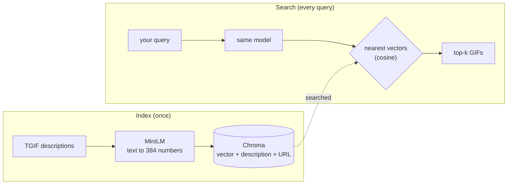

<div align="center">


# GIFt

**Find the GIF you mean, not the one you typed.**
Semantic GIF and video search: describe a scene in plain words and get matches by *meaning*, not keywords.

[](https://github.com/Davii-Ng/GIFt/actions/workflows/repo-hygiene.yml)
[](LICENSE)


[Quick start](#quick-start) · [Features](#features) · [How it works](#how-it-works) · [Usage](#usage) · [Layout](#repository-layout) · [Contributing](#contributing)

</div>

<br>

```text
 "a dog being confused"   ──▶   embed   ──▶   nearest vectors   ──▶   GIFs
```

GIFt ships **gifly**, a browser app for finding and saving GIFs. It also includes a Streamlit app with like/dislike feedback and a webcam "GIF mirror", an HTTP API, and a benchmark for comparing retrieval methods.

## Features

| | |
|---|---|
| **gifly website** | Shuffled home feed, paged GIF search, previews with Download and copyable links. One search bar for GIFs and videos. |
| **Create GIF** | Upload a short personal video, trim, crop and rotate it, then export a looping GIF up to 480p at 12 fps. No text overlay or quality selector. |
| **Your contribution** | A durable library tied to your Firebase UID. Edit names/descriptions, switch Public/Private, download, retry or delete your own GIFs. Public names and descriptions are searchable, with a relevance weight of ×1.02. |
| **Automatic ranking** | A background benchmark picks between semantic (MiniLM), BM25 and hybrid ranking. Semantic search is the fallback while it runs. |
| **Relevance feedback** | Like or dislike results to re-rank them (Rocchio). Dislikes are remembered for similar searches. |
| **Accounts** | Firebase sign-up and sign-in with per-account favorites in Cloud Firestore. See [Firebase setup](FIREBASE_SETUP.md). |
| **Gemini search** | Optional Gemini-embedding index for GIFs and text-to-video search over local clips. |
| **GIF mirror** | In the Streamlit app, a webcam photo becomes a search phrase for the emotion it shows. |
| **Benchmark** | BM25, MiniLM, Qwen3, BGE-M3 and hybrid retrieval compared on a frozen 10,000-caption / 200-query split. |

## Quick start

**Requirements:** Python 3.11 or newer and about 2 GB of disk for PyTorch and the model. The first run needs internet to download the TGIF descriptions (about 18 MB) and the MiniLM model (about 90 MB). GIF images always load from their original URLs.

```powershell
python -m venv .venv
.\.venv\Scripts\python.exe -m pip install -r requirements.txt
.\.venv\Scripts\python.exe -m web.prepare_tgif
.\start-web.ps1 -IndexData
```

Then open **http://127.0.0.1:8000**. On later runs, start with `.\start-web.ps1`.

<details>
<summary><b>macOS / Linux</b></summary>

```bash
python3 -m venv .venv && source .venv/bin/activate
pip install -r requirements.txt
python -m web.prepare_tgif
python -m web.ingest
uvicorn api:app --host 127.0.0.1 --port 8000
```

</details>

The [web guide](web/README.md) covers configuration, accounts, search modes, storage, the API and tests.

## How it works



1. **Index (once).** An embedding model (`all-MiniLM-L6-v2`) turns each GIF description into a vector. Similar meanings get similar vectors, and the vectors go into a local Chroma database.
2. **Search (every query).** The query is embedded with the same model. Chroma returns the closest stored vectors by cosine similarity, and the GIFs behind them are shown.

The same model must be used in both steps, or the vectors are not comparable.

## Usage

| Task | Command |
|------|---------|
| Run gifly (website + API) | `.\start-web.ps1` |
| Build the small sample index (5,000 GIFs) | `python -m gift.index --limit 5000` |
| Search from the terminal | `python -m gift.search a dog being confused` |
| Streamlit app (Gemini, feedback, GIF mirror) | `streamlit run apps/streamlit_app.py` |
| HTTP API only | `uvicorn api:app --host 127.0.0.1 --port 8000` |
| Build the Gemini GIF index | `python -m gift.gemini.index` |
| Embed local video clips | `python -m gift.video.embed` |
| Search videos from the terminal | `python -m gift.video.search --query "a dancing cartoon"` |
| Run the retrieval benchmark | `pip install -r requirements-benchmark.txt` then `python -m benchmark --help` |

Gemini and video features need `GEMINI_API_KEY` in the environment. The API serves the website at `/`, search at `/search?q=...&k=9`, and interactive docs at `/docs`.

## Repository layout

```text
.
├── gift/              shared code
│   ├── config.py      paths, model names, settings
│   ├── data.py        download and load the TGIF dataset
│   ├── index.py       build the sample Chroma index
│   ├── search.py      search_gif(query, k)
│   ├── gemini/        Gemini index and search, feedback (Rocchio), emotion
│   └── video/         video embedding and text-to-video search
├── web/               gifly: FastAPI backend, plain JS frontend, accounts
├── apps/              Streamlit app
├── api.py             HTTP API entry point (serves web/)
├── benchmark/         retrieval benchmark, datasets, reports
├── notebooks/         learning notebooks
├── tests/             API tests
└── data/              generated, git-ignored
```

Tests live next to what they test: `web/tests/`, `benchmark/tests/` and `tests/`.

## Testing

```powershell
.\.venv\Scripts\python.exe -m unittest discover -s web/tests -v
.\.venv\Scripts\python.exe -m unittest tests.test_api
.\.venv\Scripts\python.exe -m pytest benchmark/tests
node --test web/tests/api-client.test.mjs
```

## Learn the ideas

New to embeddings and vector search? Start with [`notebooks/concepts.ipynb`](notebooks/concepts.ipynb): embeddings, similarity and vector databases, with no index needed (about 20 minutes). Then try [`notebooks/gif_search.ipynb`](notebooks/gif_search.ipynb), a walkthrough on the real GIF data. It needs the sample index from `python -m gift.index`.

```powershell
python -m ipykernel install --user --name gif-search
jupyter notebook notebooks/
```

Pick the `gif-search` kernel and run cells top to bottom. Notebook outputs are stripped in git.

## Contributing

Contributions are welcome.

- Install the local checks once per clone: `pip install pre-commit; pre-commit install`. They block commits of files over 1 MB or anything under `data/`, and CI runs the same checks on every pull request.
- Put new shared code under `gift/`. Settings belong in `gift/config.py`.
- Generated data (`data/`, `web/.chroma`, `web/.cache`, `web/.local`) is git-ignored. Do not commit it.
- Never commit secrets. Use environment variables or a `.env` file, which is git-ignored.
- Keep commits small and run the [tests](#testing) before opening a pull request.

## Troubleshooting

<details>
<summary><b>Broken images</b></summary>

GIFs are hosted on third-party sites and some old links are dead. The site keeps the description and original link when an image fails.

</details>

<details>
<summary><b>"No GIF index found"</b></summary>

Run `python -m gift.index`, or build the full web index with `.\start-web.ps1 -IndexData`. To rebuild the sample index, delete `data/chroma_db/` and run the command again.

</details>

<details>
<summary><b>"Search is not ready"</b></summary>

Run `python -m web.ingest`, then restart the server.

</details>

<details>
<summary><b><code>ModuleNotFoundError</code> in a notebook</b></summary>

The notebook is using the wrong Python. Select the `.venv` or `gif-search` kernel.

</details>

## Acknowledgements

GIFt began as a small local replica of the [Pinecone GIF search article](https://www.pinecone.io/learn/gif-search/), using Chroma instead of Pinecone. Data comes from the public [TGIF](https://github.com/raingo/TGIF-Release) dataset (about 125,000 GIF descriptions).

## License

Released under the [MIT License](LICENSE).

## Compatibility and contributions

The website uses the current `gift/` modules alongside the Streamlit app and video tooling. Legacy top-level Python commands remain available as compatibility entry points. Accounts use Firebase Authentication and Cloud Firestore; contribution files and processing jobs use persistent server storage.

See [the contribution guide](web/CONTRIBUTIONS.md) for setup, storage, limits and verification.
